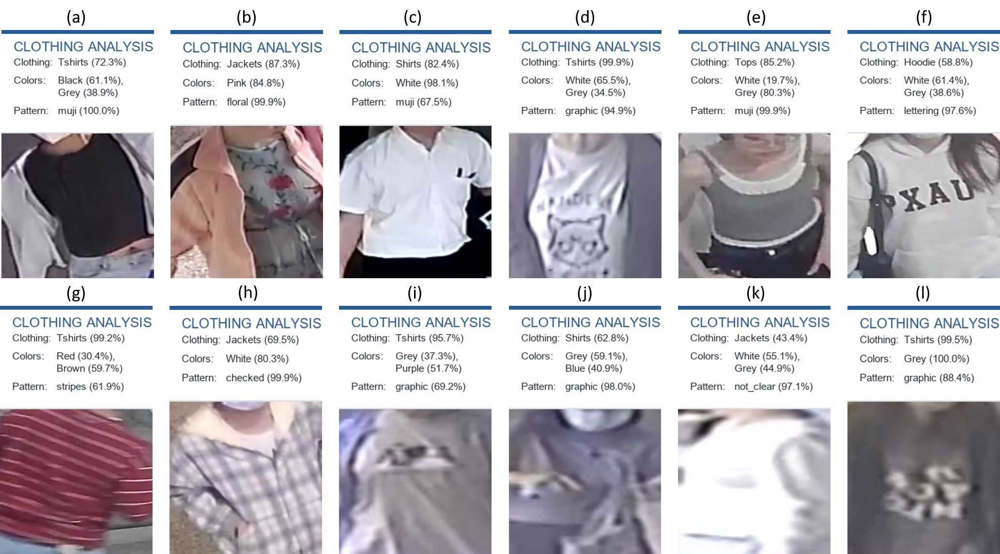

# Integrated CCTV-Based Clothing Analysis System

## Overview

This project integrates three computer vision pipelines into a unified CCTV-based clothing analysis system. It analyzes clothing in torso images extracted from CCTV footage and combines clothing-type, color, and pattern predictions into a single output.

## System Architecture

The following diagram illustrates the overall architecture of the integrated system, from CCTV video preprocessing to the final prediction and result storage.


*Figure 1. Overall architecture of the integrated CCTV-based clothing analysis system.*

## Core Components

The integrated system consists of three independent analysis pipelines:

| Pipeline | Function |
|---|---|
| **Clothing-Type Classification** | Classifies clothing into Hoodie, Jackets, Tshirts, Shirts, or Tops. |
| **Clothing-Color Analysis** | Identifies the dominant clothing colors using segmentation and color analysis. |
| **Clothing-Pattern Classification** | Classifies clothing patterns using a deep learning model. |

The predictions from these components are combined to generate a unified clothing description for each analyzed person.

## Processing Workflow

```text
CCTV Video
    ↓
Video Preprocessing
    ↓
Person Detection and Torso Cropping
    ↓
┌─────────────────────────────────┐
│   Clothing-Type Classification  │
│   Clothing-Color Analysis       │
│   Clothing-Pattern Classification│
└─────────────────────────────────┘
    ↓
Unified Prediction Generation
    ↓
Results and Annotated Images
```

## Results

The integrated pipeline combines the predictions from all three components and presents the results in an annotated image. The output includes the predicted clothing type, dominant colors, and clothing pattern.



*Figure 2. Example output showing the integrated clothing analysis predictions.*

## Output

The system is designed to provide:

- **Clothing Type:** Predicted clothing category.
- **Clothing Colors:** Detected dominant clothing colors.
- **Clothing Pattern:** Predicted clothing pattern.
- **CSV Results:** Structured prediction records.
- **Annotated Images:** Visual results displaying the predictions.

## Technologies

The integrated system combines computer vision, image segmentation, color analysis, object detection, and deep learning-based classification. Each component performs a specific task, while the integration stage combines their predictions into a unified result.

## Purpose

The project aims to support automated clothing attribute analysis in CCTV footage by combining clothing-type, color, and pattern recognition in a single modular system.
